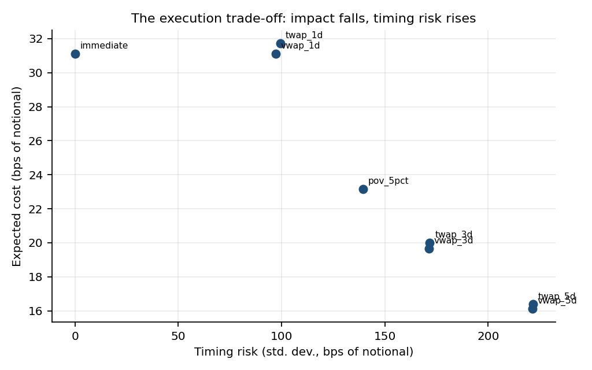
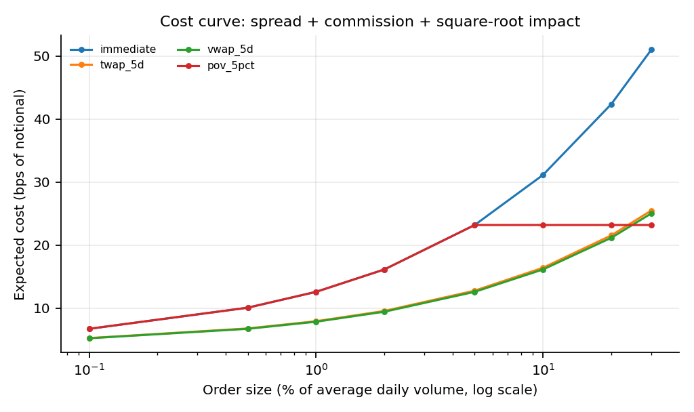
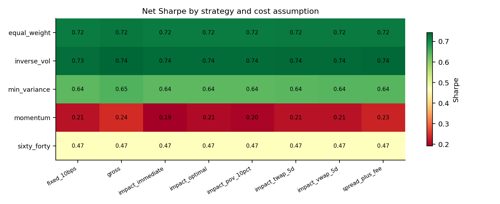
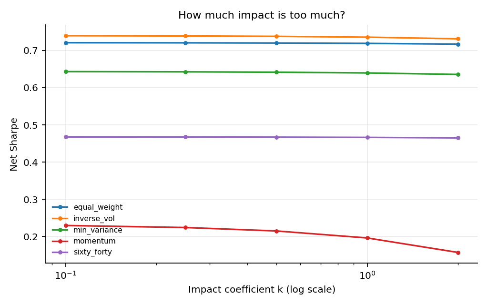
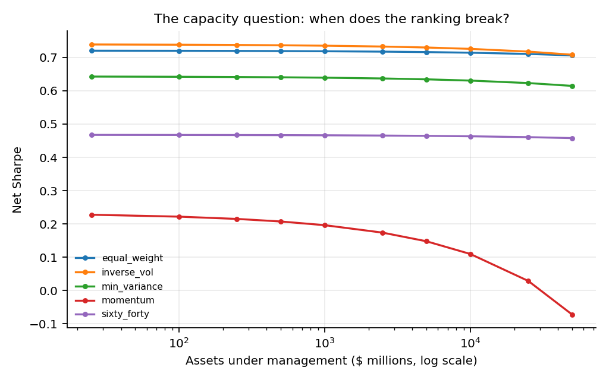
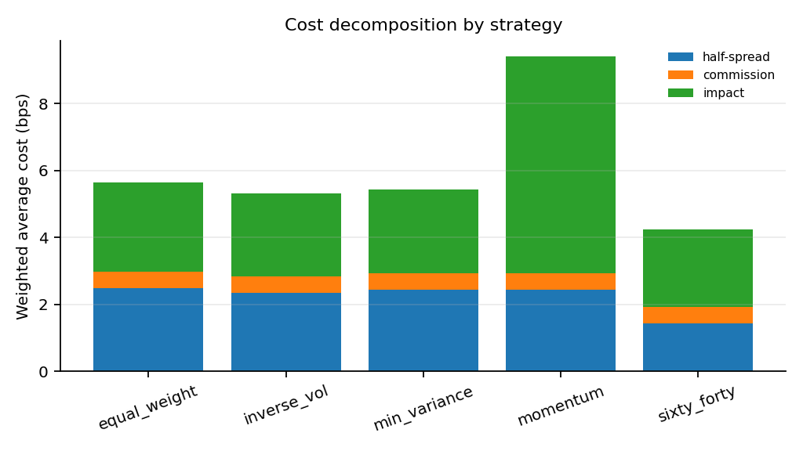

# Results — Execution & Market-Impact Lab

> **Evidence note:** this file is a committed copy of `results/demo/report.md`,
> generated by `execution-lab demo` from the checked-in synthetic panel (seed
> `20261108`). The `results/` directory is regenerated and git-ignored; this copy
> and the figures in `docs/figures/` are the evidence. The demo is a method
> demonstration on synthetic data, not an empirical claim about real ETFs.

---

## Generated report

**Status:** generated by `execution-lab demo`. This is a method demonstration on synthetic data, not an empirical claim about real ETFs.

- **Data:** synthetic ETF panel, seed 20261108
- **Panel:** 6 tickers, 1825 daily rows
- **Simulation window:** 2018-12-31 to 2024-12-30
- **Assets under management:** $250,000,000
- **Model:** half-spread + 0.5 bp commission + k=0.5 square-root impact; risk aversion 0.05

## 1. One order, many schedules

The least-liquid asset in the panel is **VNQ**. A 10%-of-ADV order is **$31,078,478** against **$310,784,779** of daily dollar volume. The table is the cost decomposition, not a forecast of a particular day.

| schedule | participation | half_spread_bps | impact_bps | expected_cost_bps | timing_risk_bps | objective_bps |
| --- | --- | --- | --- | --- | --- | --- |
| vwap_5d | 2.00% | 3.48 | 12.14 | 16.12 | 221.41 | 27.19 |
| twap_5d | 2.00% | 3.48 | 12.40 | 16.39 | 221.63 | 27.47 |
| vwap_3d | 3.33% | 3.48 | 15.67 | 19.65 | 171.26 | 28.21 |
| twap_3d | 3.33% | 3.48 | 16.01 | 20.00 | 171.72 | 28.58 |
| pov_5pct | 5.00% | 3.48 | 19.19 | 23.17 | 139.44 | 30.14 |
| immediate | 10.00% | 3.48 | 27.14 | 31.12 | 0.00 | 31.12 |
| vwap_1d | 10.00% | 3.48 | 27.14 | 31.12 | 97.07 | 35.98 |
| twap_1d | 10.00% | 3.48 | 27.74 | 31.72 | 99.49 | 36.69 |

- Cheapest expected cost: **vwap_5d** at 16.12 bps.
- Lowest timing risk: **immediate** at 0.00 bps (immediate execution has none by construction).
- Lowest objective at risk aversion 0.05: **vwap_5d** at 27.19 bps.

The key trade-off is visible: spreading the order lowers impact but adds timing risk measured against the arrival price. A VWAP schedule is cheaper than TWAP at the same horizon because it matches expected volume instead of dividing time equally. POV chooses its horizon endogenously; when the target rate is above the order's participation, it collapses to a one-day VWAP and is not counted twice.

## 2. Risk-aversion frontier

The optimal schedule is a function of the risk-aversion parameter. The same order can rationally be executed immediately or spread over days depending on that preference. This table reports the best schedule at each setting.

| risk_aversion | schedule | expected_cost_bps | timing_risk_bps | objective_bps |
| --- | --- | --- | --- | --- |
| 0.00 | vwap_5d | 16.12 | 221.41 | 16.12 |
| 0.01 | vwap_5d | 16.12 | 221.41 | 18.33 |
| 0.05 | vwap_5d | 16.12 | 221.41 | 27.19 |
| 0.10 | immediate | 31.12 | 0.00 | 31.12 |
| 0.25 | immediate | 31.12 | 0.00 | 31.12 |
| 0.50 | immediate | 31.12 | 0.00 | 31.12 |
| 1.00 | immediate | 31.12 | 0.00 | 31.12 |

## 3. Does the strategy ranking survive costs?

Every strategy is run on the same gross return path, then charged under each cost assumption. The ranking is by net Sharpe. `impact_optimal` chooses a schedule per trade from the pre-declared menu.

| strategy | gross | fixed_10bps | spread_plus_fee | impact_vwap_5d | impact_optimal |
| --- | --- | --- | --- | --- | --- |
| equal_weight | 0.722 | 0.718 | 0.721 | 0.720 | 0.719 |
| inverse_vol | 0.743 | 0.734 | 0.740 | 0.738 | 0.735 |
| min_variance | 0.646 | 0.638 | 0.644 | 0.642 | 0.639 |
| momentum | 0.241 | 0.214 | 0.233 | 0.215 | 0.206 |
| sixty_forty | 0.468 | 0.465 | 0.468 | 0.467 | 0.466 |

**Ranks** (1 = best net Sharpe):

| strategy | gross | fixed_10bps | spread_plus_fee | impact_vwap_5d | impact_optimal |
| --- | --- | --- | --- | --- | --- |
| equal_weight | 2 | 2 | 2 | 2 | 2 |
| inverse_vol | 1 | 1 | 1 | 1 | 1 |
| min_variance | 3 | 3 | 3 | 3 | 3 |
| momentum | 5 | 5 | 5 | 5 | 5 |
| sixty_forty | 4 | 4 | 4 | 4 | 4 |

At this AUM the ranking is unchanged across the cost models. That is a property of this synthetic panel and this order size, not evidence that implementation costs never matter. The reason is arithmetic: the cost *differences* between adjacent strategies are smaller than their gross Sharpe gaps. The largest absolute loss to impact is 0.026 Sharpe, but it belongs to momentum, which is already last by a wide margin; the smallest gross gap is 0.020. The AUM and k tables below show where absolute edges, rather than ranks, break.

**Implementation fragility** — Sharpe lost to 5-day VWAP impact:

| strategy | gross_sharpe | impact_sharpe | sharpe_lost |
| --- | --- | --- | --- |
| momentum | 0.241 | 0.215 | 0.026 |
| inverse_vol | 0.743 | 0.738 | 0.005 |
| min_variance | 0.646 | 0.642 | 0.005 |
| equal_weight | 0.722 | 0.720 | 0.002 |
| sixty_forty | 0.468 | 0.467 | 0.001 |

## 4. Sensitivity to the impact coefficient

`k` is not identified from daily data. The honest output is a range and a break-even, not a point estimate. The break-even below is the `k` at which the strategy's net Sharpe equals its fixed-10bps Sharpe, or zero (no edge). `None` means the target is outside the `[0, 10]` bracket. A common reason on `vs_fixed` is that the fixed-10bps baseline is already cheaper than the spread-plus-commission cost, so no non-negative impact coefficient can restore parity; the naive baseline is not conservative for that asset.

| strategy | fixed_10bps_sharpe | break_even_k_vs_fixed | break_even_k_vs_zero |
| --- | --- | --- | --- |
| equal_weight | 0.718 | 1.398 | — |
| inverse_vol | 0.734 | 1.454 | — |
| min_variance | 0.638 | 1.449 | — |
| momentum | 0.214 | 0.526 | 5.603 |
| sixty_forty | 0.465 | 1.807 | — |

| strategy | k | sharpe | cost_drag_bps |
| --- | --- | --- | --- |
| equal_weight | 0.100 | 0.721 | 2.269 |
| equal_weight | 0.500 | 0.720 | 3.648 |
| equal_weight | 1.000 | 0.719 | 5.376 |
| equal_weight | 2.000 | 0.717 | 8.842 |
| inverse_vol | 0.100 | 0.740 | 4.000 |
| inverse_vol | 0.500 | 0.738 | 6.402 |
| inverse_vol | 1.000 | 0.736 | 9.413 |
| inverse_vol | 2.000 | 0.731 | 15.462 |
| min_variance | 0.100 | 0.643 | 3.497 |
| min_variance | 0.500 | 0.642 | 5.533 |
| min_variance | 1.000 | 0.640 | 8.084 |
| min_variance | 2.000 | 0.636 | 13.207 |
| momentum | 0.100 | 0.230 | 21.483 |
| momentum | 0.500 | 0.215 | 48.254 |
| momentum | 1.000 | 0.196 | 82.406 |
| momentum | 2.000 | 0.157 | 153.100 |
| sixty_forty | 0.100 | 0.468 | 1.512 |
| sixty_forty | 0.500 | 0.467 | 2.682 |
| sixty_forty | 1.000 | 0.466 | 4.148 |
| sixty_forty | 2.000 | 0.465 | 7.086 |

## 5. Capacity: the same strategy at different AUM

Impact scales with the square root of participation, so it grows faster than linearly in AUM while return does not. The table is the net-Sharpe rank at each AUM level. A rank need not change for capacity to bind: a strategy can lose its absolute edge while keeping its ordinal position.

| strategy | $25M | $100M | $250M | $500M | $1B | $2.5B | $5B | $10B | $25B | $50B |
| --- | --- | --- | --- | --- | --- | --- | --- | --- | --- | --- |
| equal_weight | 2 | 2 | 2 | 2 | 2 | 2 | 2 | 2 | 2 | 2 |
| inverse_vol | 1 | 1 | 1 | 1 | 1 | 1 | 1 | 1 | 1 | 1 |
| min_variance | 3 | 3 | 3 | 3 | 3 | 3 | 3 | 3 | 3 | 3 |
| momentum | 5 | 5 | 5 | 5 | 5 | 5 | 5 | 5 | 5 | 5 |
| sixty_forty | 4 | 4 | 4 | 4 | 4 | 4 | 4 | 4 | 4 | 4 |

| strategy | $25M | $100M | $250M | $500M | $1B | $2.5B | $5B | $10B | $25B | $50B |
| --- | --- | --- | --- | --- | --- | --- | --- | --- | --- | --- |
| equal_weight | 0.721 | 0.720 | 0.720 | 0.720 | 0.719 | 0.718 | 0.717 | 0.715 | 0.711 | 0.707 |
| inverse_vol | 0.739 | 0.739 | 0.738 | 0.737 | 0.736 | 0.733 | 0.730 | 0.726 | 0.718 | 0.709 |
| min_variance | 0.643 | 0.642 | 0.642 | 0.641 | 0.640 | 0.637 | 0.635 | 0.631 | 0.623 | 0.615 |
| momentum | 0.227 | 0.222 | 0.215 | 0.207 | 0.196 | 0.174 | 0.148 | 0.109 | 0.028 | -0.073 |
| sixty_forty | 0.468 | 0.467 | 0.467 | 0.467 | 0.466 | 0.466 | 0.465 | 0.463 | 0.461 | 0.458 |

**AUM at which net Sharpe first crosses zero** (linear interpolation between grid points; not a capacity estimate):

| strategy | first_non_positive_aum |
| --- | --- |
| momentum | $32.0B |
| equal_weight | — |
| inverse_vol | — |
| min_variance | — |
| sixty_forty | — |

## 6. What this does not show

- **No order-book realism.** The model uses daily OHLCV and a high-low spread proxy, not quotes or depth.
- **No intraday path.** Timing risk is a zero-drift random-walk standard deviation; it is not a simulated execution path.
- **No identified `k`.** The coefficient is a sensitivity parameter. The demo is designed to show how the answer moves with it.
- **No live-trading claim.** There is no routing, brokerage connection, or alpha claim.
- **Synthetic data.** The strategy dispersion is generated, not observed. The ranking results illustrate the method; they are not evidence about real ETFs.

## Reproduce

```bash
pip install -e .
execution-lab demo --out results/demo
```

The checked-in demo panel is generated by `scripts/make_demo_data.py` from a fixed seed. A run manifest with the panel hash and parameter values is written next to this report.

---

## Figures












