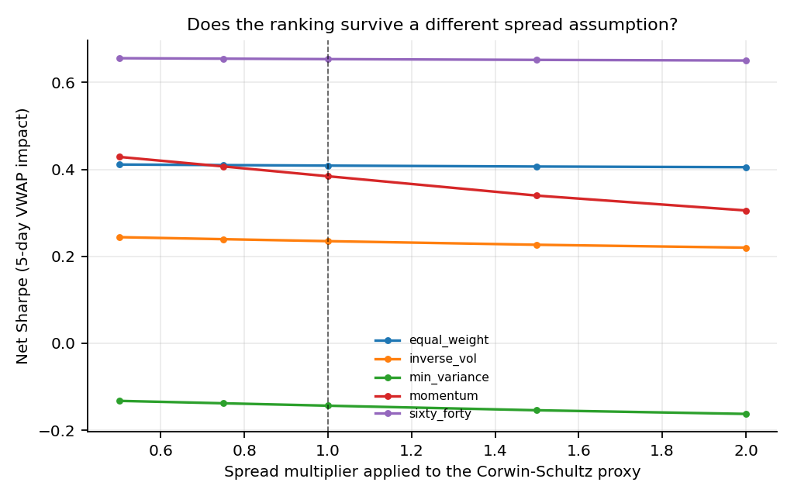

# Spread-Proxy Sensitivity — Real-Data Check

> **Data note:** local validation on the owner's licensed Yahoo Finance ETF snapshot. The raw data are not redistributed. This is a daily-data exercise, not an execution simulator.

The real-data check uses the Corwin-Schultz high-low estimator as the spread proxy. That estimator can overstate the quoted spread. This analysis reruns the ranking at 0.5x, 0.75x, 1x, 1.5x, and 2x the proxy, holding everything else fixed.

## Net Sharpe under 5-day VWAP impact

| strategy | 0.5 | 0.75 | 1.0 | 1.5 | 2.0 |
| --- | --- | --- | --- | --- | --- |
| equal_weight | 0.411 | 0.410 | 0.409 | 0.407 | 0.405 |
| inverse_vol | 0.244 | 0.239 | 0.235 | 0.227 | 0.220 |
| min_variance | -0.132 | -0.138 | -0.144 | -0.154 | -0.162 |
| momentum | 0.429 | 0.407 | 0.384 | 0.340 | 0.306 |
| sixty_forty | 0.656 | 0.655 | 0.654 | 0.652 | 0.650 |

## Ranks (1 = best)

| strategy | 0.5 | 0.75 | 1.0 | 1.5 | 2.0 |
| --- | --- | --- | --- | --- | --- |
| equal_weight | 3 | 2 | 2 | 2 | 2 |
| inverse_vol | 4 | 4 | 4 | 4 | 4 |
| min_variance | 5 | 5 | 5 | 5 | 5 |
| momentum | 2 | 3 | 3 | 3 | 3 |
| sixty_forty | 1 | 1 | 1 | 1 | 1 |

## Equal weight vs momentum

| spread_multiplier | equal_weight_sharpe | momentum_sharpe | equal_weight_minus_momentum | equal_weight_rank | momentum_rank | equal_weight_ahead |
| --- | --- | --- | --- | --- | --- | --- |
| 0.500 | 0.411 | 0.429 | -0.018 | 3 | 2 | no |
| 0.750 | 0.410 | 0.407 | 0.003 | 2 | 3 | yes |
| 1.000 | 0.409 | 0.384 | 0.024 | 2 | 3 | yes |
| 1.500 | 0.407 | 0.340 | 0.067 | 2 | 3 | yes |
| 2.000 | 0.405 | 0.306 | 0.100 | 2 | 3 | yes |



## Verdict

The flip does **not** survive the full multiplier grid. It disappears at 0.5× the
proxy and is effectively a tie at 0.75×. The honest headline is therefore that
momentum is implementation-fragile, not that the rank order is robustly changed.

## What this does and does not settle

- It tests sensitivity to the *level* of the spread proxy, not to its cross-sectional shape or its correlation with volatility.
- It does not identify the true quoted spread; that requires quote data.
- It does not change the synthetic demo, which is a separate reproduction path.

## Reproduce

```bash
python scripts/run_spread_sensitivity.py
```
